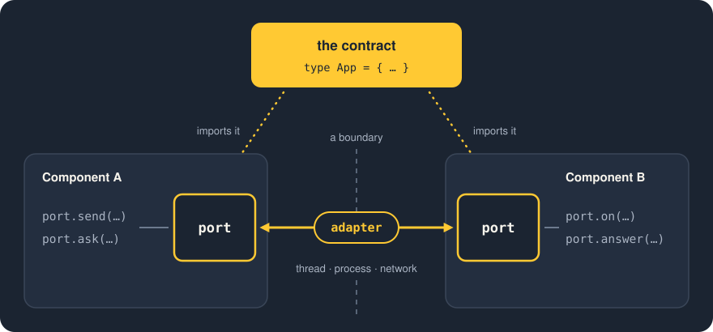
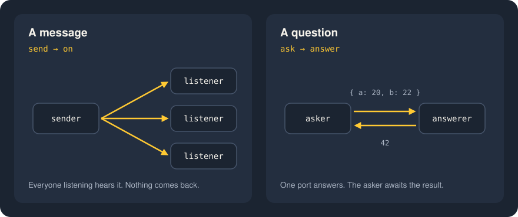
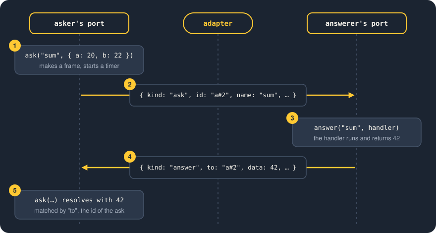
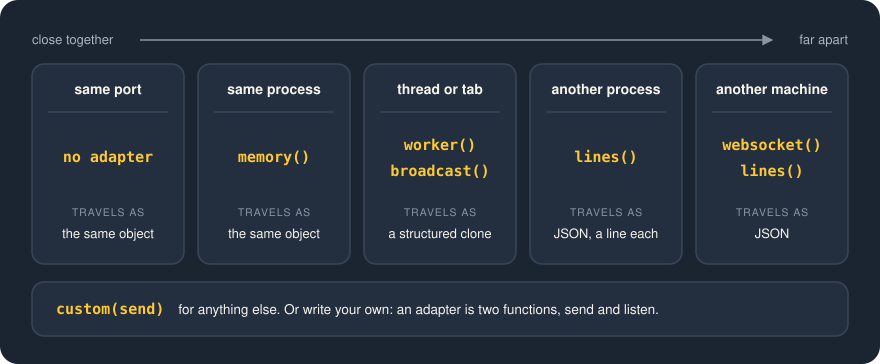
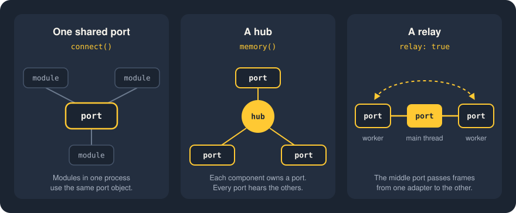
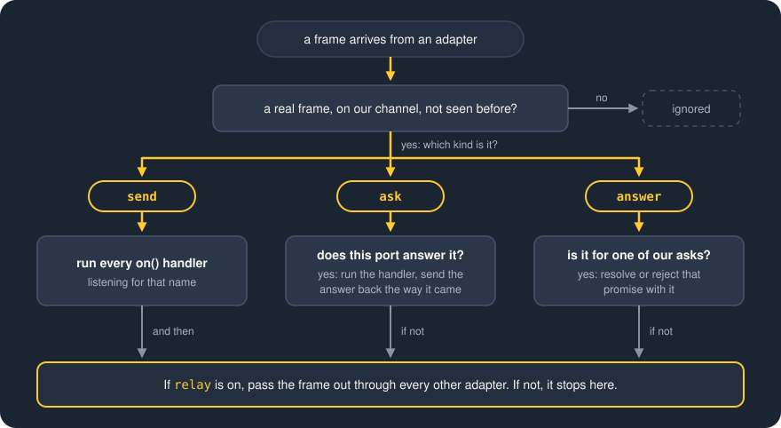

# 공항, explained

A walk through 공항 for someone who has never seen it: what it is for, the few ideas it is built from, how a message actually travels, and where everything lives in the code. The [README](../README.md) is the reference for everyday use. This page is the map.

공항 is pronounced *gonghang* and is Korean for "airport".

## What it is for

The parts of a program need to talk to each other, and how they do it usually depends on where they live:

| Where the two parts live | What you would normally write |
|---|---|
| The same process | function calls, or an event emitter |
| A page and its worker | `postMessage` and `onmessage` |
| A browser and a server | a WebSocket and hand-rolled JSON |
| A parent process and its child | lines on stdin and stdout |

Each has its own API, and none of them checks that the two sides agree on what is being said. Move a component across one of those lines and you rewrite how it talks.

공항 puts one small API over all of them. You describe what can be said once, as a TypeScript type. Every component talks through a **port**, using the same few verbs. What sits between two ports is an **adapter**, and swapping it is a one-line change.

The whole library is one file, [`src/index.ts`](../src/index.ts), with no dependencies.

## The idea in one picture



- **The contract** is a TypeScript type listing everything that can be said. Every component imports it, so both ends are checked against the same list.
- **A port** is the object a component talks through. Each component opens its own with `connect<Contract>()`.
- **An adapter** carries what the ports say across one boundary: to another thread, another process, another machine.

A port with no adapter still works. It reaches the handlers registered on that same port, which is already a typed event bus for one process.

## The words

| Word | What it means here |
|---|---|
| **contract** | The TypeScript type that lists every message and question by name. |
| **message** | Something one port sends and every listener hears. Nothing comes back. |
| **question** | Something one port asks and one port answers. The asker gets the answer as a promise. |
| **port** | What a component talks through. Made by `connect()`. |
| **adapter** | Two functions, `send` and `listen`, that move frames across one boundary. |
| **frame** | The plain object that actually travels. One per send, ask or answer. |
| **hub** | A meeting point that several ports connect to. |
| **relay** | A port option. When on, the port passes frames from one of its adapters out through the others. |
| **channel** | A label on every frame. Ports ignore frames from other channels. The default is `"main"`. |

## Two ways to talk



The contract decides which is which. An entry whose type is a function is a question. Anything else is a message.

```ts
// contract.ts
export type App = {
  "user.joined": { name: string };                    // a message
  sum: (input: { a: number; b: number }) => number;   // a question
};
```

```ts
import { connect } from "@justin06lee/gonghang";
import type { App } from "./contract";

const port = connect<App>();

// A message: send it, and every listener hears it.
port.on("user.joined", ({ name }) => console.log(`hi ${name}`));
port.send("user.joined", { name: "justin" });

// A question: ask it, and await the one answer.
port.answer("sum", ({ a, b }) => a + b);
const total = await port.ask("sum", { a: 20, b: 22 }); // 42
```

Because the port is typed by the contract, names autocomplete, payloads are checked, and `total` is a `number`. Sending a question or asking a message is a compile error.

That is the whole API:

| Call | What it does |
|---|---|
| `port.send(name, data)` | Tell everyone. |
| `port.on(name, handler)` | Hear a message every time. Returns a function that stops listening. |
| `port.once(name)` | A promise for the next one. Rejects if the port closes first. |
| `port.ask(name, input)` | Ask, and await the answer. |
| `port.answer(name, handler)` | Be the one who answers. Returns a function that steps down. |
| `port.close()` | Stop listening, fail every ask and `once` still waiting, let go of the adapters. |

Three details worth knowing early:

- A question takes one input. To pass several values, put them in an object, as `sum` does.
- A port hears its own messages. `send` reaches the `on` handlers on the same port too.
- Each port can have one answerer per question. Registering a second one throws.

## What happens when you ask



1. Your code calls `ask`. The port builds a **frame**, gives it a unique id, notes that it is owed an answer, and starts a timer (5 seconds unless you set `timeout`).
2. The adapter carries the frame across.
3. The port on the other side finds its `answer` handler for that name and runs it.
4. Whatever the handler returned goes back in a second frame, whose `to` is the id of the ask.
5. The first port matches `to` against the asks it is waiting on, cancels the timer, and resolves the promise.

If the port that asks also holds the answerer, it answers itself and nothing leaves the port.

Frames are plain data, so they survive JSON and structured cloning. These are the two from the picture:

```json
{"channel":"main","id":"a#2","from":"a","kind":"ask","name":"sum","data":{"a":20,"b":22}}
{"channel":"main","id":"b#1","from":"b","kind":"answer","name":"sum","to":"a#2","data":42}
```

A message is the same thing with `"kind":"send"` and no reply. That is everything there is on the wire, so a component written in another language can join in by reading and writing these objects.

### When an ask fails

| What happened | What the asker gets |
|---|---|
| The handler threw | An `Error` with the same `name`, `message`, `code` and stack. The class does not cross, so check `error.name`, not `instanceof`. |
| The question or its answer could not be sent, because the data does not survive the trip | The error that says why, straight away. |
| Nobody answered in time | A `PortError` with code `"timeout"`. |
| The port has no adapters and no answerer | A `PortError` with code `"unanswered"`, straight away. |
| The other side went away | A `PortError` with code `"disconnected"`, as soon as the adapter notices. |
| The port closed first | A `PortError` with code `"closed"`. |

A `once` still waiting when its port closes rejects with the same `"closed"` error.

## Crossing a boundary



Pick the adapter by how far apart the two components are, and hand it to `connect`. Nothing else in the component changes.

```ts
// main.ts
const port = connect<App>(worker(new Worker("./worker.ts")));

// worker.ts
const port = connect<App>(worker(self));
```

| Adapter | Reaches |
|---|---|
| *none* | Handlers on the same port. |
| `memory()` | Every port given the same hub, in one process. |
| `worker(target)` | The other side of a `postMessage`: a Worker, `self` inside one, a MessagePort. |
| `broadcast(name)` | Everything that opened the same BroadcastChannel name. |
| `websocket(socket)` | The other end of a WebSocket. Frames sent before it opens wait for it. |
| `lines(input, output)` | The other end of a pair of streams: a child process, a TCP socket, a pipe. |
| `custom(send)` | Anything that hands you messages in a callback, such as a WebSocket server. |

How the data travels matters. With no adapter or `memory()`, handlers get the very same object, so don't mutate it. `worker` and `broadcast` deliver a structured clone. `websocket` and `lines` send JSON, so only JSON-safe data survives.

An adapter is small enough to write yourself. This one is node's process IPC:

```ts
import type { Adapter } from "@justin06lee/gonghang";

const ipc = (child: ChildProcess): Adapter => ({
  send: (frame) => child.send(frame),
  listen: (receive, gone) => {
    child.on("message", receive);
    child.on("exit", gone); // optional: say when the other side has left for good
    return () => child.off("message", receive); // optional: how to stop
  },
});
```

`receive` takes a frame or the JSON text of one and ignores everything else, so pass it whatever arrives without checking first. Call `gone` if you can tell that the other side has left for good, and asks waiting on it fail at once instead of timing out.

## Shapes you can build



**One shared port.** The simplest setup. Create one port, export it, and let every module in the process import it.

**A hub.** Give each component its own port and connect them all to one `memory()`. Every port hears the others. This is also how the tests put both sides of a conversation in one file.

```ts
const hub = memory();
const billing = connect<App>(hub);
const emails = connect<App>(hub);
```

**A relay.** A port can hold several adapters. It talks through all of them, but it keeps them apart unless `relay` is on. With it on, the port in the middle passes frames along, so the two ends can talk to each other:

```ts
// The main thread, letting two workers talk to each other.
connect<App>([worker(first), worker(second)], { relay: true });
```

Relay is off by default on purpose. With it on, everything connected hears everything.

**One port per connection.** A server usually wants the opposite of a hub: a separate port for each client, so what it sends goes to that client only. `custom` is made for this. See [`examples/websocket/server.ts`](../examples/websocket/server.ts).

## What a port does with a frame that arrives



Every frame that comes in through an adapter takes the same path:

1. **The gate.** Anything that is not a frame is ignored, so a transport can carry other traffic too. So is a frame from another channel, and a frame whose id this port has already handled. That last check is what makes loops safe: however many routes a frame takes, each port handles it once. A port remembers the last 5,000 ids.
2. **By kind.** A `send` runs the `on` handlers. An `ask` is answered if this port holds the answerer. An `answer` settles the ask it belongs to.
3. **Relay.** An ask this port answered, or an answer to one of its own asks, stops there. Anything else is passed out through the port's other adapters, but only if `relay` is on.

## Options

`connect(adapters, options)` takes these:

| Option | Default | What it does |
|---|---|---|
| `channel` | `"main"` | Ports only hear ports on the same channel. |
| `name` | random | Stamped on every frame as `from`. |
| `timeout` | `5000` | How long `ask` waits, in milliseconds. `0` waits forever, and so does anything over about 24 days. One ask can set its own: `port.ask(name, input, { timeout: 500 })`. |
| `relay` | `false` | Pass frames between this port's adapters. |
| `stacks` | `true` | Send stack traces along with errors. Turn it off on a server whose clients are strangers. |
| `tap` | none | A function that sees every frame going in or out. Good for logging. |
| `onError` | `console.error` | Where errors thrown inside `on` handlers, `tap` and adapters go. |
| `onDisconnect` | none | Told when an adapter says its other side has left for good, with the adapter that said so. |

## What it leaves to you

공항 is small on purpose. These are the things it does not do, so you know to handle them where they matter:

- **Nothing is stored.** A message reaches the ports listening at that moment. A port that connects later never sees it.
- **A dead link is noticed only where the transport says so.** `websocket`, `lines`, MessagePorts and bun or node workers report it, and the asks waiting on them fail at once with `"disconnected"`. Browsers and deno give no sign that a `Worker` has died, and a port is never told about what lies beyond a relay. There an ask still ends at its timeout, and never if the timeout is `0`. A `once()` has no timeout at all: it waits for as long as its port stays open.
- **No reconnecting.** An adapter wraps a connection you made. If it drops, making a new one is up to you.
- **No authentication.** A port trusts its adapters: whatever arrives is treated as coming from a peer. On a public socket, check inside your handlers who is asking and what they sent.

Extra behaviour such as compression, encryption, validation or reconnecting belongs in an adapter that wraps another adapter. The ports never know it is there.

## A map of the code

| Path | What is in it |
|---|---|
| [`src/index.ts`](../src/index.ts) | The whole library. |
| [`test/port.test.ts`](../test/port.test.ts) | How ports behave: messages, questions, errors, timeouts, relay, close. |
| [`test/adapters.test.ts`](../test/adapters.test.ts) | Every adapter over the real thing: workers, a WebSocket server, child processes, TCP. |
| [`test/types.ts`](../test/types.ts) | The type-level tests. It is never run; it only has to compile. |
| `test/contract.ts`, `test/fixtures/` | The contract the tests share, and the small programs on the far end of each transport. |
| [`test/smoke.mjs`](../test/smoke.mjs) | A short run of the built file, on bun and on node and deno where they are installed. |
| [`examples/`](../examples) | One small "kitchen" program, run over a worker, a child process and a WebSocket. |
| `Makefile` | `make` installs, typechecks, tests, builds, and runs the smoke test. |

`src/index.ts` reads top to bottom in four parts:

1. **The contract types.** `MessageName`, `QuestionName`, `Input` and `Output` work out from your contract which names are messages, which are questions, and what each takes and returns.
2. **The pieces.** The `Frame`, `Adapter`, `Options` and `Port` interfaces, and `PortError`.
3. **`connect()`.** The one function with real logic in it. A port is a few small tables and the functions that use them:
   - `listeners`: message name → the `on` handlers for it
   - `answerers`: question name → the one `answer` handler for it
   - `waiting`: ask id → the promise still owed an answer, and its timer
   - `onces`: how to fail each `once` still waiting, if the port closes
   - `seen`: the ids of frames already handled
   - `lost`: the adapters whose other side has left for good
4. **The adapters.** `memory`, `worker`, `broadcast`, `websocket`, `lines` and `custom`. Each is a few lines that turn one kind of transport into `send` and `listen`.

## Try it

You need [Bun](https://bun.sh). If node or deno are installed too, `make` also runs the built file on them.

```sh
make                               # install, typecheck, test, build, smoke test
bun test                           # just the tests

bun examples/worker/main.ts        # a worker thread
bun examples/process/parent.ts     # a child process over stdin and stdout
bun examples/websocket/server.ts   # a server; run examples/websocket/client.ts beside it
```

Each example asks for a price, places an order, and hears it come back ready:

```
bibimbap costs 12
table 4: bibimbap is ready
```

From here, the [README](../README.md) covers each adapter and option in more detail.
